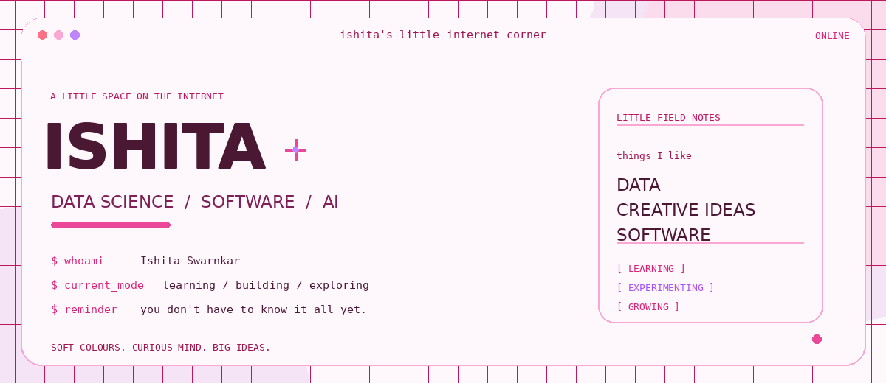

 

&nbsp;

  

WELCOME TO MY LITTLE CORNER OF THE INTERNET

# hi, i'm ishita.

data science · software · little ideas that turn into big rabbit holes

I'm Ishita. I like figuring out how things work, trying ideas that might fail, and turning the interesting ones into something real.

I'm into data, AI, and software, but I also love when things have personality. I want what I make to work well and feel like someone cared about the details.

Still learning, still experimenting, still becoming.

<table>
<tr>
<td width="50%" valign="top">

### a little analytical

I enjoy breaking complicated problems into smaller pieces until they start making sense.

</td>
<td width="50%" valign="top">

### a little creative

I care about the details, the feeling, and making things look as good as they work.

</td>
</tr>
<tr>
<td width="50%" valign="top">

### always curious

One question can turn into a whole evening of trying things and learning something unexpected.

</td>
<td width="50%" valign="top">

### very much a work in progress

I don't need to know everything yet. I just need to keep going.

</td>
</tr>
</table>

01 / MY LITTLE TOOLBOX

## things i like working with

<table>
<tr>
<td width="33%" valign="top">

**languages**

Python  
Java  
C++  
C  
JavaScript  
SQL

</td>
<td width="33%" valign="top">

**data things**

Pandas  
NumPy  
Scikit learn  
Statistics  
Data analysis  
Visualisation

</td>
<td width="33%" valign="top">

**building things**

FastAPI  
MySQL  
Git  
REST APIs  
HTML and CSS  
Backend development

</td>
</tr>
</table>

  

also exploring / pytorch · langgraph · qdrant · faiss · retrieval systems

02 / LITTLE THINGS I'M WORKING ON

## growing one step at a time

<table>
<tr>
<td width="50%" valign="top">

**getting stronger**

Building better foundations in statistics, machine learning, Python, SQL, and problem solving.

</td>
<td width="50%" valign="top">

**exploring**

Learning how AI systems work and how to turn ideas into useful software.

</td>
</tr>
<tr>
<td width="50%" valign="top">

**making things**

Trying ideas, learning new tools, and working through the messy middle between an idea and a working result.

</td>
<td width="50%" valign="top">

**my tiny rule**

Understand it before pretending to know it. Ask questions. Keep going.

</td>
</tr>
</table>

03 / THE GITHUB CORNER

## little signs of life

  

  

Real links to my GitHub, no mystery stats cards needed.

04 / END OF MY LITTLE PAGE

# soft colours. curious mind. big ideas.

I'm still figuring things out, and that's part of the fun.

I'm here to learn, make things, change my mind, and get better at what I do.

If you're building something interesting, come say hi.

 

  

ISHITA / A LITTLE SPACE ON THE INTERNET / MADE WITH CARE

