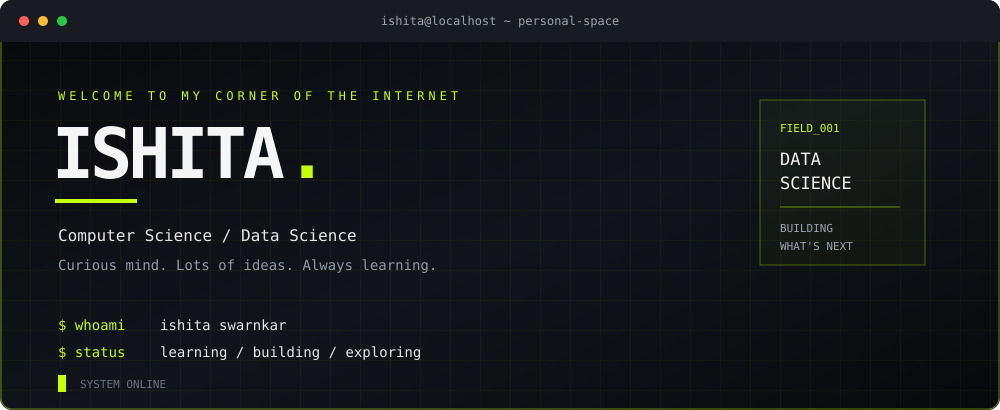

&nbsp;

NOT A RESUME. JUST A LITTLE CORNER OF THE INTERNET.

I’m Ishita. I like figuring out how things work, trying ideas that might fail, and turning the interesting ones into something real.
I’m into data, AI, and software, but I also care about how things are presented. A project should work well, make sense, and feel like someone actually cared about the details.
I’m still learning. That’s not a disclaimer. That’s the whole point.
<table>
<tr>
<td width="50%" valign="top">

THE LOGIC
I enjoy breaking complicated problems into smaller pieces until the solution starts making sense.
</td>
<td width="50%" valign="top">

THE DETAILS
I care about the little things too: the interface, the flow, the names, and whether something feels finished.
</td>
</tr>
<tr>
<td width="50%" valign="top">

THE RABBIT HOLES
One question can become an experiment, then a new idea, then an entire evening spent figuring it out.
</td>
<td width="50%" valign="top">

THE PROCESS
Learn something. Try it. Get it wrong. Understand why. Try again. Keep the parts worth keeping.
</td>
</tr>
</table>

01 / THE TOOL DRAWER
THINGS I LIKE WORKING WITH

<table>
<tr>
<td width="33%" valign="top">

LANGUAGES
Python
Java
C++
C
JavaScript
SQL
</td>
<td width="33%" valign="top">

DATA
Pandas
NumPy
Scikit-learn
Statistics
Data analysis
Visualisation
</td>
<td width="33%" valign="top">

BUILDING
FastAPI
MySQL
Git
REST APIs
HTML and CSS
Backend development
</td>
</tr>
</table>

ALSO EXPLORING / PYTORCH · LANGGRAPH · QDRANT · FAISS · RETRIEVAL SYSTEMS

02 / THE NOW PAGE
CURRENTLY IN PROGRESS

<table>
<tr>
<td width="50%" valign="top">

GETTING STRONGER
Building better foundations in statistics, machine learning, Python, SQL, and problem solving.
</td>
<td width="50%" valign="top">

EXPLORING
Learning how AI systems work and how to turn ideas into useful, reliable software.
</td>
</tr>
<tr>
<td width="50%" valign="top">

MAKING THINGS
Trying ideas, learning new tools, and working through the messy middle between “what if?” and “it works.”
</td>
<td width="50%" valign="top">

A SMALL RULE
Understand it before pretending to know it. Ask questions. Keep going.
</td>
</tr>
</table>

03 / THE GITHUB WINDOW
A LITTLE PROOF OF LIFE

These links open your real GitHub pages. No third-party stats card required.

04 / END OF TRANSMISSION
STILL BECOMING.
I don't have everything figured out, and I don't think I need to.
I'm here to learn, make things, change my mind, and get better at the work.
If you're building something interesting, come say hi.

ISHITA SWARNKAR / PERSONAL SPACE / STILL UNDER CONSTRUCTION

